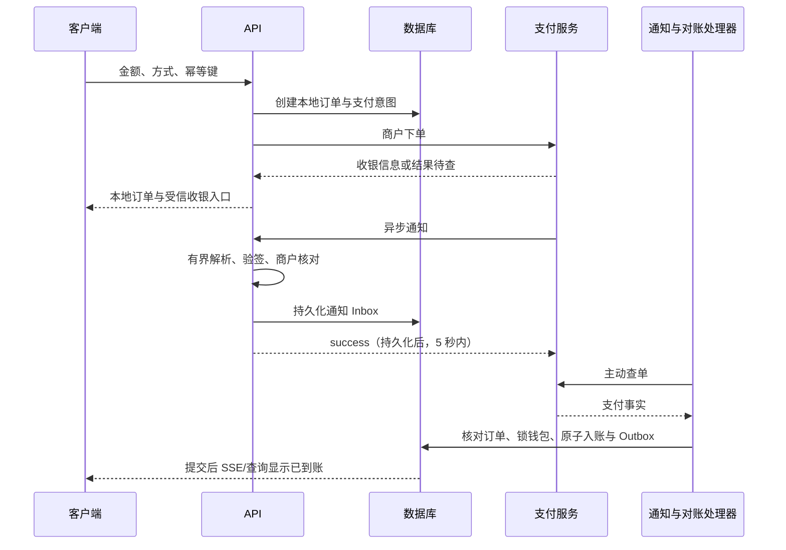

# 钱包、计费、ZPay 与对账

## 1. 已核查的提供商范围

用户已确认真实提供商为 `https://zpayz.cn`。已读取其 [开发文档](https://zpayz.cn/doc.html)、[商户接入协议](https://zpayz.cn/news_8.html) 与首页。公开协议自述服务商为淄博卓付信息科技有限公司；真实商户号/密钥、开通渠道、经营类别与通道能力仍需在联调时配置和核对。

不能将其他“易支付”实现直接套为 ZPay 标准。实现前固定提供商 ID、域名、协议版本、商户主体和测试证据。未知提供商不启用真实收款。

已确认站点的文档列出 `submit.php`、`mapi.php`、订单查询和退款接口；签名为其定义的 MD5 拼接方式，异步通知成功状态为 `TRADE_SUCCESS`，接收端需处理重复通知并返回 `success`，官方强烈建议主动查单。

## 2. 金额与账本

资金按人民币整数分记录。Go 使用受限的 int64 和溢出校验；API 用十进制字符串传递最小单位，例如 `"amount_minor":"3000"`，避免 JavaScript/Flutter Web 数字精度问题。由严格的十进制解析处理支付平台的元字符串，不用 float64 乘 100。

账本采用 journal + signed postings，不可变更已提交记录；钱包可用/预占字段是事务内更新的缓存，可从账本重建。每个 journal 同币种变动和为零，具有唯一业务键、原因和关联对象。

| 业务 | 分录示例（分） | 业务唯一键 |
| --- | --- | --- |
| 充值 30 元 | 用户可用 +3000；渠道清算 -3000 | recharge / 提供商 / 商户 / 渠道交易号 |
| 预占 2 元 | 用户可用 -200；用户预占 +200 | hold / 收费意图 / 预占版本 |
| 实际消费 1.5 元 | 用户预占 -150；服务收入 +150 | capture / 收费意图 / 结算单元 |
| 释放剩余 0.5 元 | 用户预占 -50；用户可用 +50 | release / 预占 / 释放单元 |
| 服务退款 1.5 元 | 服务收入 -150；用户可用 +150 | service_refund / 原消费 / 退款编号 |
| 原路退款预留 | 用户可用 -R；退款应付 +R | payout_reserve / 退款编号 |
| 渠道退款成功 | 退款应付 -R；渠道清算 +R | payout / 退款编号 |

服务费用退回钱包与原充值原路退款是不同业务，不能共用一个“退款”布尔值。人工调整使用独立 journal，并关联操作者、理由和复核记录，不能直接修改余额数字。

资金写事务按固定顺序锁钱包/账本账户，校验非负可用余额及预占约束，提交分录、缓存、业务状态和 Outbox。进度或支付网络请求不在锁内。

## 3. 已确认按用量，价格暂缓

主服务采用用量计费，计量单位已确定为“平台已确认的有效任务点数量”；题库按输入/输出 token 独立计费。整门课程固定价不作为主模式。单价、计价精度和结算批次仍待配置，不能自行选择后当作已批准价格。不能把进程存活时间、等待验证时间、请求次数或合成播放位置作为可收费量。

一次主服务计量事件绑定内部用户、稳定账号主体、课程/周期、稳定任务点键和平台确认事实；只在任务点首次由新鲜平台查询确认通过、且此前未计费时产生一次。执行观察、排队、失败、等待验证、普通无编号附件、重复执行和重试都不产生新计量。执行前已被平台确认或已经计费的任务点不重复计量；课程周期重置需重新验证稳定键。

用量链路为：确认报价和上限 → 预占 → 记录规范用量事件 → 核验可结算量 → 按价格快照结算 → 释放剩余预占。金额与计量均采用明确的整数最小单位，价格使用有界整数分子/分母运算，禁止浮点累积和每次重试重复舍入。

建议实体为 `usage_meters`、`usage_records` 和 `usage_settlements`：记录计量类型/版本、稳定计费范围、唯一用量事件、起止/数量证据、价格版本、结算与冲正引用。计费范围必须来自已授权且可验证的服务，实际单位确定前不得生成真实扣款。

同一任务点跨任务重试、安排重叠和恢复只结算一次。预占可按计划内待确认任务点估算，最终按已确认事件结算，未确认部分释放。已批准收费意图保留价格快照，改价不静默覆盖旧报价。

题库查询使用独立收费意图和流水，明确与主服务区分。单价、缓存命中、超时/失败成本及结算成功条件继续暂缓；没有公布并获确认的规则就不开启真实收费，不把建议自动解释为用户同意。

所有已结算用量证据按财务层保留，不能随普通过程日志到期删除，见 [数据保留](data-retention.md)。

### 3.1 题库 token 计费

题库单独计费，主服务不复用任务用量价格。每次答案查询是一个独立收费意图，绑定公开模型条目、价格版本、作答方式、用户查询 ID 和 fork 的 `request_id`。

计费事实来自 fork v2 响应的 `usage.calls`：图片转述、回答模型和 agent 多轮分别列明输入/输出 token。主平台不把客户端上报的 token 当作依据，也不把 fork 数据库当唯一账本；fork 只提供受信服务的事实，主平台负责价格、预占、结算和审计。

**价格表示**：管理员以“每 100 万输入/输出 token 的微元”配置价格。1 微元 = 0.000001 元，全部整数，不使用浮点。`price_version` 在用户确认查询时固定。

**计算**：

```text
cost_micros = floor((input_tokens * input_price_micro_per_million
                   + output_tokens * output_price_micro_per_million) / 1_000_000)
```

示例：输入 1,284 token、输出 96 token，输入价 3,000,000 微元/百万、输出价 9,000,000 微元/百万：

```text
(1284 * 3,000,000 + 96 * 9,000,000) / 1,000,000
= (3,852,000,000 + 864,000,000) / 1,000,000
= 4,716 微元 = ¥0.004716
```

价格与单价仅为公式示例，不是已发布价格。缓存命中时输入/输出 token 均为 0，`cost_micros` 为 0；若未来启用缓存检索费，使用独立价格字段，不把它伪装成 token 费用。

**舍入与结算**：钱包仍以整数分记账，微元费用不能每笔直接四舍五入到分。建议按用户累计 `cost_micros`，达到 10,000 微元（1 分）后结算一次，或在安排结束、账户关闭时做一次有明确规则的尾差处理；每个结算批次生成一条账本 capture，保留原始 token、价格版本和未舍入分子。真实阈值、最小收费和尾差规则在定价时确认，当前不启用自动扣费。

**预占**：查询前用题目长度、模型上限和 `max_output_tokens` 估算最坏成本并预占；若实际用量超过预占，不能静默透支，应停止后续 agent 迭代或在响应中返回 `budget_exceeded`，超出的上游成本进入人工核对。缓存命中返回 0 token，释放预占；缓存未命中才进入模型计费。

**失败与重试**：只有 `usage.complete=true` 且状态成功的调用可自动结算；超时、上游断开、用量缺失、`ERROR:` 空答案或模型返回不完整时标记 `usage_incomplete`，不自动扣费，交由人工或用户重新查询。相同 `request_id` 的重试不重复调用模型、不重复收费；不同查询不能因为题目文字相似而复用收费意图。

**缓存**：`cache_first` 命中不产生模型 token；`always_llm` 每次都产生实际 token。缓存是否收费、共享缓存是否启用、缓存 TTL 和命中失败的补偿均未定价，不能默认收“缓存费”。

**核对**：定期比较主平台已结算 token 汇总与 fork 调用记录、上游服务账单；差异保留证据并暂停相关自动结算。token 数字来自上游响应，不是密码学证明；高金额查询可抽样人工复核。

## 4. 充值流程与原子性



通知接收与资金提交可以异步分离，保证 5 秒通知期限；回复成功仅表示通知已可靠保存，不表示钱包已经到账。Inbox 无法持久化时返回可重试错误，不能提前应答。

下单超时保留原商户单号，先查单，不直接换号重试制造第二笔付款。商户单号遵守本提供商文档最多 32 位的限制，建议使用受唯一约束保护的数字字符串；不把大数字当 JSON Number。

## 5. 通知验证与旧签名协议

按已确认提供商的官方文档：参数名 ASCII 升序；排除 `sign`、`sign_type` 和空值；参数值不进行 URL 编码；以 `a=b&c=d` 形式拼接后直接追加商户 KEY；MD5 输出小写。不能改为 `&key=` 或自行换算法后仍声称兼容。

实现时拒绝重复参数和超大请求，严格解析金额和状态；使用与官方样例对应的黄金测试向量，处理一次 URL 解码和加号语义，常量时间比较摘要。MD5 是该提供商旧协议的限制，不称为现代安全签名。

入账前同时核对：提供商与商户号、本地订单、渠道交易号唯一性、币种上下文（该接口按人民币）、金额、实际支付状态及允许的渠道。主动查单结果必须来自固定可信域名与 TLS，禁止跳转携带密钥。

查询 API 把 KEY 放查询参数是该协议的事实：传输必须 HTTPS，访问日志和 HTTP 追踪必须去掉密钥及完整 URL，不能让通用错误记录原请求。密钥只在服务端使用，不发给 Web、App 或管理员页面。

验签失败拒绝；已验证但金额/订单不符的通知持久化隔离并报警，禁止入账。重复有效通知幂等确认，事务唯一键是最后防线。

## 6. 订单与到账分离

订单保存独立维度：本地生命周期、渠道支付状态、账务入账状态、退款状态。客户端“返回成功”只触发服务端查询。

| 客户端显示 | 服务端事实 |
| --- | --- |
| 待支付 | 没有已核实付款 |
| 支付成功，入账处理中 | 已查明支付成功，账本提交尚未完成 |
| 已到账 | 唯一入账 journal 已提交 |
| 已关闭 | 本地支付流程结束，不抹掉后来到达的真实付款 |
| 需要核对 | 金额、商户、重复付款或渠道状态异常 |

本地关闭后若实际付款成功，必须进入迟到支付核验，按明确规则到账或退款，不能忽略资金。用户实际支付两笔与同一笔通知重复不同：两笔真实资金分别记录，不能靠回调去重吞掉第二笔钱。MVP 一个本地订单绑定一个有效商户支付意图，切换方式新建订单并保留旧订单对账。

## 7. 用量费用、暂停与失败

执行前按已批准价格快照和预算上限预占。结算依赖被核验的有效用量，暂停、排队、等待验证或本地时钟结束不直接产生扣款；单价或结算规则未配置前保持真实计费关闭。

相同用量只结算一次，失败和重试不通过新尝试 ID 创建第二笔费用。失败释放未消费预占；已经实际产生的外部题库成本按后续公布的独立规则处理，不临时追加扣费。

平台核验不明时保留明确的处理状态和时限，不抢先释放后继续执行。核验、结算和冲正使用同一计量/价格版本及租约屏障，避免用户与管理员同时重试造成重复计费。

余额不足只阻止新的付费领取；已预占的业务按明确规则继续或安全停止。充值到账后由用户确认继续，已完成的消费保留证据。

预占释放、消费纠错和正常充值退回是独立语义，不能因为普通充值不退款就扣留未消费预占。

## 8. 退款与对账

用户已确定正常充值到账的余额原则上不退回；MVP 不提供普通余额自助退款、提现或用户间转账。异常支付、重复付款/扣款、误记账、渠道或法律要求处理的情形保留人工复核，不能用一般不退款规则忽略实际资金。

本提供商退款文档说明大多数通道需要与原订单金额一致，因此不承诺任意部分退款。异常退款核对原订单、未消费来源和渠道能力后由专用权限操作，记录原因与审计，不默认自动退回正常充值。

`funding_lots` 和消费分配跟踪每次充值的未使用部分，防止拿其他充值余额掩盖原订单已消费金额。退款超时进入结果待查，不重复发送不具备幂等保障的退款请求；确认原结果后再推进。

定期扫描已创建未明订单、已付未到账、到账金额差异、退款待查和孤立通知。建议 1 分钟处理近期异常、每日核对汇总，具体频率受提供商额度限制。无官方完整对账文件时使用受限订单查单和商户可导出的账单，不能声称已有标准对账 API。

对账发现账本不平、缓存余额不符或重复交易号时冻结相关资金操作，保留证据并报警。余额不可在不同用户之间自由转账或提现；存储型余额与经营资质另行评估。

## 9. App 渠道

首期 App 按自有下载站分发：Android 为签名 APK，iOS 在有效签名和适用分发条件满足后配置入口。支付能力由服务端按实际平台、地区和商户通道控制。未来进入 App Store 或 Google Play 时再按对应数字服务政策与例外核对，不把一个 H5 收银入口视为所有分发方式通用。

提供商已确认。真实支付的启用条件仍包括：商户配置和经营类别核对、用量/题库收费规则及退款说明明确、通知/查单/故障恢复测试通过，并完成对应分发方式和隐私核查。自有下载站的支付能力见 [分发设计](distribution.md)。
