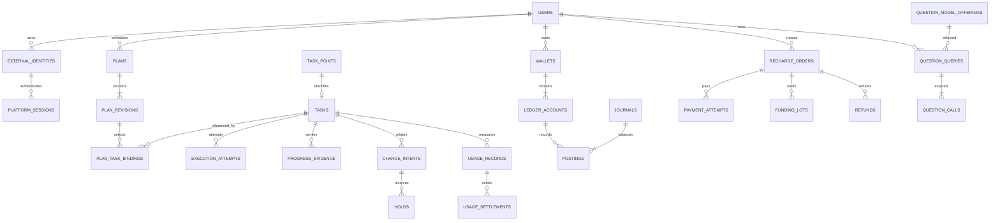

# PostgreSQL、实体关系与版本迁移

## 1. 已确认的选型

用户已明确选择 PostgreSQL。正式服务统一使用 PostgreSQL，不再开发 SQLite 后端、双数据库兼容层或 SQLite → PostgreSQL 迁移路径。

当前没有正式业务数据库和生产数据，不做旧业务库迁移。主服务的身份、学习、资金/支付、题库编排、事件与隐私迁移位于 `server/internal/platform/postgres/migrations/`，独立题库有自己的数据库和迁移。PostgreSQL16+为唯一主数据库；当前验证使用隔离PostgreSQL16.15。实际迁移与状态以源码及 [当前实现](../development/local-implementation.md) 为准，下文保留实体职责与一致性设计。

| 项目 | 正式方案 |
| --- | --- |
| 数据库 | 受支持的 PostgreSQL 稳定版本，实施时固定主/补丁版本 |
| 部署 | Linux 原生 PostgreSQL 或用户提供的合适托管实例，不要求 Docker |
| Go 连接 | PostgreSQL 专用连接池与显式事务，不为未规划数据库保留方言抽象 |
| 钱包并发 | 按钱包/账本账户行锁，固定加锁顺序与业务唯一键 |
| 任务领取 | 状态条件更新、活跃尝试唯一约束，候选领取可用 `FOR UPDATE SKIP LOCKED` |
| 事件 | 业务事务 Outbox，提交后分配有序投递流 |
| 备份 | 一致性备份与恢复演练，按 RPO/RTO 增加 WAL 归档或托管恢复 |

数据库承担身份、课程、任务、账本、支付、审计和事件的持久化。不因为选择 PostgreSQL 就增加微服务、Redis、消息队列或多节点部署。

## 2. 写负载不能按账号数判断

写负载近似由以下部分组成：

```text
观察写入率 ≈ 实际运行任务数 / 检查点合并间隔
总写入 = 观察检查点 + 租约续期 + 状态变化 + 安排修改
       + 资金事务 + 支付 Inbox + 审计 + Outbox/投递流
```

例如 200 个运行任务、15 秒合并一次，只有观察更新就约 13.3 次/秒；这只是计算示例，不是已测容量。租约可批量续期，过程事件可合并；账务事务和平台确认不能丢弃。

容量验证测量：锁等待、事务提交 P95/P99、通知 Inbox 延迟、钱包请求延迟、WAL 增长、长事务和备份期间表现。PostgreSQL 的连接数、观察合并间隔和索引按实际负载调整，不把演示并发值当作生产容量。

## 3. 一致性与运行参数

资金事务使用行锁并维持 `fsync`、`synchronous_commit` 和正常崩溃恢复配置。锁钱包及关联账本账户时按稳定顺序获取；死锁与序列化冲突限次重试，事务内不发网络请求。连接池按主机资源配置，不照搬演示并发值。

使用受限业务角色、版本化 SQL 迁移、明确隔离级别和 `statement_timeout` / `lock_timeout` 等限制。迁移权限与日常业务写入权限分离；长报表分页，避免长期事务影响正常运行。

维护币种与整数分约束、业务唯一键、版本条件更新和账本重建校验。没有通过终止进程、故障恢复与资金对账测试前，不提供财务正确性的运行承诺。

## 4. 核心实体

所有业务主键使用服务端生成的稳定字符串 ID，升级和恢复时保留。时间保存 UTC，API 使用带时区时间。敏感主体、Cookie 与密钥存密文或引用，不作为明文索引内容。

| 实体 | 关键字段 | 约束与用途 |
| --- | --- | --- |
| users | id、状态、创建时间、删除状态 | 内部账务主体，不要求注册用户名密码 |
| external_identities | user_id、provider、namespace、主体索引、版本 | 有效主体唯一，归属不可随意改写 |
| platform_sessions | identity_id、密文、key_version、到期、版本 | 加密，按身份隔离 |
| execution_grants | user_id、范围、能力、同意版本、撤销时间 | 授权与登录会话分离 |
| client_sessions / admin_sessions | 主体、摘要、轮换链、到期、撤销 | 管理员和用户分表/独立域 |
| admin_users / roles / permissions | 管理员、角色、权限 | 不存在普通用户自动成为管理员的映射 |
| courses / chapters / resources | 外部组合键、快照版本、显示信息 | 普通资源独立于任务点 |
| task_points | 稳定外部任务键、课程、周期、平台事实 | 缺失标识不生成可执行任务 |
| plans / plan_revisions | user_id、current_revision、范围、优先级 | 不可变版本，安排记录条件更新 |
| plan_task_bindings | revision_id、canonical_task_id | 多安排共享规范任务 |
| tasks | 规范任务、state、desired_state、control_version | 稳定任务范围唯一 |
| execution_attempts | task_id、阶段、版本、token、租约、检查点 | 一个任务最多一个有效副作用尝试 |
| progress_evidence | task_id、attempt_id、来源、查询时间、事实 | 观察、平台确认、媒体证据分开 |
| question_queries / learning_work_runs | 查询内容与用量、冻结安排版本、试卷指纹、查询引用和提交状态 | 查询与自动提交分离，原题敏感字段限期保留 |
| wallets / ledger_accounts | user_id、currency、可用/预占缓存 | 用户币种钱包唯一，缓存可由账本重建 |
| journals / postings | 业务键、关联对象、账本账户、整数变动 | 业务键唯一，每笔 journal 变动和为零 |
| question_offerings | 公开名称、fork 上游引用、能力、启停、默认、价格版本、输入/输出微元价、缓存策略 | 题库目录的只读镜像；由题库面板发布并同步，主库不承担定价权 |
| question_queries | 用户/任务、公开条目、作答方式、缓存作用域、fork request_id、答案快照、用量汇总、价格版本、微元成本、完成状态 | 查询与提交分离；相同 request_id 幂等 |
| question_calls | query_id、slot（caption/answer/agent）、输入/输出/total token、上游模型、状态、时间 | 每次模型调用的分解；用于展示和核对 |
| learning_work_runs | task_id、plan_revision_id、试卷指纹、公开模型、模式、query_ids、答案摘要、提交状态 | 任务级最终提交独占，提交前检查租约；结果不明只核验 |
| question_submissions | 旧接口历史记录 | 新流程不再写入；历史记录保留 |
| usage_meters / usage_records / usage_settlements | 计量版本、稳定范围、唯一用量事件、证据、结算/冲正引用 | 主服务和题库独立；相同量跨重试和安排只计一次 |
| charge_intents / holds | 收费主体键、价格快照、预占/消耗/释放 | 主服务和题库独立范围，重试共享意图，不按尝试 ID 新收费 |
| recharge_orders / payment_attempts | 本地单号、金额、渠道、支付/到账状态 | 商户单号唯一，渠道交易号唯一 |
| payment_inbox / refunds | 去重键、验签摘要、处理结果、退款状态 | 通知持久化，退款流程可恢复 |
| funding_lots / allocations | 来源充值、可退款额、消费分配 | 防止退款超过原充值可退款范围 |
| idempotency_requests | 主体、方法/路径、键、请求摘要、结果引用、期限 | 同键同意图复用，过期意图重新确认 |
| audit_events / data_requests | 操作者、理由、对象、脱敏变更、请求状态 | 关键操作留痕，不含凭据 |
| outbox / stream_heads / stream_entries | 事件 UUID、资源版本、流序号、投递状态 | 事务事实与提交后有序投递分开 |
| user_preferences / admin_preferences | 配色、浅深模式、通知、版本 | 默认石墨，两类身份偏好隔离 |

## 5. 实体关系



非课程任务等未来业务可扩展收费主体类型；不把所有财务交易强行外键到执行尝试。

**题库 fork 使用独立 PostgreSQL 数据库**（建议 `ocs_tiku`）和独立角色。主要表为 `tiku.offerings`（公开条目与费率）、`tiku.offering_price_versions`（只追加价格版本）、`tiku.model_overrides`、`tiku.model_tests`、`tiku.requests`、`tiku.queries`、`tiku.model_calls`、`tiku.cache_entries` 和 `tiku.panel_audit`；主平台不直接读取这些表，也不做跨数据库 join。主平台保存目录镜像、查询事实、token 汇总、冻结价格快照和账本引用。

公开条目 `provider_ref` 是 fork 配置中的模型引用；上游服务名、模型名、地址和密钥留在 fork 的受保护配置中，不进入主库或浏览器。主库 `question_offerings` 以题库条目 UUID 为关联键，价格版本与费率随每次目录读取同步；已发生查询另存冻结快照。主库价格版本表和主库模型测试表已删除。

答案缓存按 `cache_key`、作用域、公开条目、规范化/提示词版本和 TTL 存储；缓存条目不是账本，不能代替 `question_queries` 或资金证据。

## 6. 索引与数据隔离

用户可访问表携带 `user_id` 或有可验证的归属链；Repository 查询必须带主体，控制器不接受客户端自报 user_id 作为授权依据。对任务、订单、钱包等重点表使用复合外键/应用约束防止跨用户关联。

必要索引包括：用户课程组合键、任务稳定键、任务状态和下次尝试时间、有效租约、用户订单时间、本地订单号、渠道交易号、账务业务键、用户流水、Outbox 未投递记录、流键与序号；题库公开条目、`question_queries.request_id`/user_id/时间、fork `answer_cache.cache_key`/expires、fork request idempotency。报表使用聚合快照，避免管理首页每次全表扫描。

跨行借贷平衡不能仅靠单行 CHECK 保证。通过受限的账务入口、同一事务和并发测试保证；可增加 PostgreSQL 延迟约束验证。定期重建对账发现异常即停止相关资金操作。

## 7. PostgreSQL schema 升级与恢复

当前没有待迁移的旧业务库，正式开发直接建立 PostgreSQL schema。后续维护仅围绕 PostgreSQL 的版本化迁移和必要的大版本升级：

1. 在与目标环境一致的 PostgreSQL 主版本上演练迁移，检查索引、约束和锁影响。
2. 常规升级优先使用兼容旧/新程序的扩展再收敛策略；需要停写时停止新领取并安全停止副作用。
3. 维护窗口中的支付通知明确返回可重试错误，不回复未持久化的成功；恢复后主动查单补偿。
4. 升级前创建可恢复备份，保留身份、任务、密文、账本、订单、预占、幂等键、Inbox/Outbox 和事件游标。
5. 核对逐用户余额、journal 平衡、充值/消费/退款、约束与审计；不能只核对总行数。
6. 恢复时先核验任务和支付事实，完成账务检查后再开放新收费与领取。
7. 程序回滚必须符合 schema 兼容范围；不可逆变更不直接指回旧备份继续写账。

不维护双数据库契约测试。并发、幂等、恢复、迁移与备份测试统一针对正式 PostgreSQL。分层 TTL、财务证据保留、异机备份和容量预算见 [数据保留](data-retention.md) 与 [2C4G / 30GB 基线](capacity.md)。