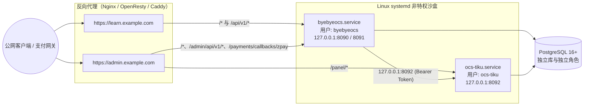

# 生产部署拓扑与安全沙盒架构

> **适用范围**：公开用户生产环境的部署架构与安全隔离设计，对应 `deploy/` 脚本集、`deploy/systemd/` 单元模板与 `configs/` 示例配置。操作步骤见 [Linux 原生部署指南](../../deploy/README.md)。

## 1. 主机进程与反向代理拓扑

生产环境采用“前置 HTTPS 反向代理 + 本机回环双 Go 守护进程 + 本机或受控 TLS PostgreSQL”的最小攻击面拓扑：

- **双域名严格分离**：`auth.user_origin` 与 `auth.admin_origin` 必须为两个不同的 HTTPS Origin，从浏览器同源策略层隔绝管理员会话 Cookie、CSRF 域与用户端前端环境。
- **受信任代理解析**：Go 服务强制只监听回环地址，仅当直连对端命中 `server.trusted_proxies`（默认 `127.0.0.1/32` 与 `::1/128`）时才解析单跳 `X-Forwarded-For` 作为限流与审计客户端 IP，防止伪造请求头绕过登录限流。

## 2. 目录所有权与 systemd 安全加固

`deploy/install.sh` 与 `deploy/systemd/*.service.in` 实施纵深权限收敛：

1. **双非 root 服务账号**：`byebyeocs` 与 `ocs-tiku` 为两个无登录 Shell 的独立系统用户，安装脚本强制拒绝二者同名。
2. **读写路径最小化**：
   - `/opt/byebyeocs/releases/<version>` 与 `/opt/byebyeocs/current` 由 `root` 所有且全局只读，业务进程无权自修改二进制或前端静态资产。
   - `byebyeocs.service` 开启 `NoNewPrivileges=true`、`PrivateTmp=true`、`ProtectSystem=strict`、`ProtectHome=true`、`UMask=0077`，仅对 `/var/lib/byebyeocs`（数据导出与恢复门控）及运行时的主配置文件路径（供 `owner` 热调并发参数原子写回）授予必要写权限；`secrets/` 下的密钥与 DSN 保持 `0600`。
   - `ocs-tiku.service` 同样运行在严格沙盒下，仅开放 `/etc/ocs-tiku` 目录给 `ocs-tiku` 用户，供 `/panel/` 维护面板在保存上游模型时原子写回 JSON 配置与 `0600` 密钥文件。
3. **禁止 Web 执行系统命令**：两个 Go 进程内不包含任何通过 Web 接口调用 `sh`、`pg_dump`、`systemctl` 或 `sudo` 的代码路径；安装、迁移、备份与恢复全部通过受操作系统权限管控的独立 CLI 或 `systemd.timer` 执行。

## 3. 原子发布、互斥锁与回滚契约

- **自校验发布包**：`scripts/build-bundle.sh` 拒绝打包任何 `debug` 产物、`.apk` 或符号链接，生成全文件 SHA-256 `checksums.txt` 并在打包末尾自校验；目标机执行 `install.sh`、`upgrade.sh` 或 `rollback.sh` 时首先复核校验和、CPU 架构与 `release.json` 清单。
- **`flock` 前缀互斥与原子软链切换**：同一 `--prefix` 目录下的安装、升级、回滚与卸载全程持有文件排他锁，版本目录完整落盘后通过 `mv -Tf` 原子切换 `/opt/byebyeocs/current` 符号链接，中断自动清理半成品。
- **程序回滚与数据库演进边界**：`rollback.sh` 仅回退程序二进制与前端静态资源，绝不自动回滚或删除 PostgreSQL 表列。含兼容扩展迁移的小版本可在兼容窗口内回退程序；含破坏性结构演进或数据修正的版本须遵循升级前备份与灾难恢复计划。
