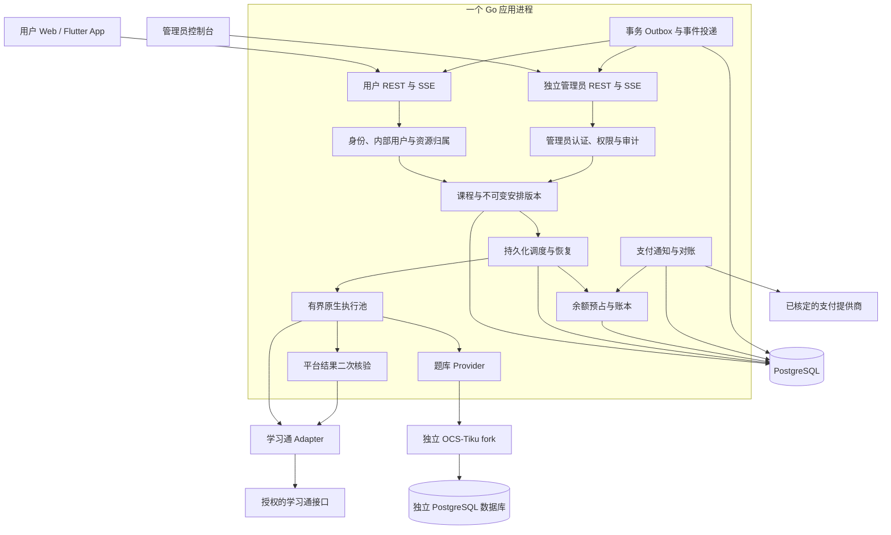

# 技术架构总览

状态：UI、PostgreSQL、Flutter、任务点与题库token分别计量、ZPay及约2C4G/30GB基线已确认。当前已形成Go业务服务、独立题库、React管理端与Flutter工程；实际验证和未验收范围见 [当前实现](../development/local-implementation.md)。本文及同目录保留全量架构设计，当前接口以 [OpenAPI](../../api/openapi.yaml)、运行配置以 [公开配置](../../configs/server.example.yaml) 为准。模型、缓存与token原则见 [决策0006](../decisions/0006-tiku-fork-token-billing.md)，分阶段验收见 [路线](../product/roadmap.md)。

## 1. 目标与明确限制

采用 Linux 原生部署的 Go 模块化单体：一个应用二进制、一个主数据库、可选独立 OCS-Tiku。数据库持久化任务、账务、审计与事件；进程内有界队列负责唤醒和执行，不承担持久化职责。不要求 Docker、Redis、消息队列、Kubernetes、浏览器或媒体解码器。

允许跨账号并发与同账号不同任务并发，同任务必须独占。少量已验证课程的实验不能证明所有任务、学校或并发量可用；真实平台验证和授权是开发门槛。

## 2. 部署与模块关系

## 3. 模块所有权

| 模块 | 持有的数据与职责 | 不承担的职责 |
| --- | --- | --- |
| Identity / Session | 外部主体验证、内部用户关联、加密会话与授权撤销 | 扣款、任务成功判定 |
| Admin / Policy | 独立管理员、RBAC、敏感操作审计 | 读取明文凭据、绕过身份验证 |
| Catalog / Plans | 课程快照、真实任务点、安排和版本 | 运行执行器、代替平台确认 |
| Scheduler | 公平排队、名额、独占、控制命令、重试和恢复 | 依靠本地计时直接宣布成功 |
| Execution / Verification | 原生适配、检查点、证据分离、二次核验 | 决定价格、直接修改钱包 |
| Question Provider | 主平台公开模型条目、答案查询、token 用量与人工确认交互 | 复制题库服务、保存上游密钥、默认自动提交测验 |
| Question Bank fork | 独立服务：上游模型、精确缓存、v2 查询、token 回传、独立 PostgreSQL | 直接修改主平台钱包、向用户暴露上游密钥 |
| Wallet / Pricing | 整数分、不可变账本、预占/结算/释放与计费快照 | 相信客户端支付返回或执行器自行报价格 |
| Payments | 下单、通知 Inbox、验签、主动查单、退款与对账 | 向客户端暴露商户密钥 |
| Events / Operations | 事务事件、SSE、运行指标、通知偏好和运维 | 作为账务或任务状态唯一来源 |

模块间通过明确应用服务调用；跨模块的一致性事务由上层用例协调。避免每个模块独立提交后再靠进程消息补齐资金状态。

## 4. 技术建议与未决项

| 项目 | 当前建议 | 状态 |
| --- | --- | --- |
| 后端 | Go、标准 HTTP、模块化单体、有界 goroutine 池 | 基础服务已实现；业务模块与执行池仍为后续设计 |
| 主数据库 | PostgreSQL，行级资金锁、并发领取与运营查询 | 用户已确认；不开发 SQLite 后端，见 database.md |
| 管理端 | React / TypeScript / Vite / Tailwind / shadcn/ui | 目标选型；当前原型使用自建组件和 Radix |
| 用户 Web / 手机 | 同一 Flutter 工程构建 Web、Android、iOS | 用户已确认，SDK 未安装，当前仍是 React 视觉原型 |
| 外观 | 默认石墨，青禾/靛蓝可选，浅深模式独立 | 用户已确认，原型已支持保存 |
| 收费 | 主服务按用量，题库单独收费 | 主服务计量单位为平台已确认的有效任务点；单价和题库具体标准由管理员配置，未配置时真实扣费关闭 |
| 支付供应商 | ZPay = zpayz.cn | 用户已确认，商户配置和通道准入待联调 |
| 发布 / 资源 | 先 Web 与原生闭环；App 自有下载站；约 2C4G / 30GB | 用户已确认，iOS 分发条件和实际容量待验证 |

## 5. 必须维持的不变量

1. 每个外部身份最多关联一个有效内部账务主体；改用户名不转移资金。
2. 用户和管理员使用独立认证；所有资源访问验证归属与权限。
3. 一个稳定任务最多一个活跃执行尝试；运行锁和数据库租约共同保护。
4. 外部副作用无法保证“恰好一次”；恢复先核验，结果不明不盲目重放。
5. 执行观察、平台通过状态、真实媒体记录分开保存。平台通过不推导真实观看。
6. 每一笔账务业务具有唯一业务键，账本借贷平衡，重试不直接重复收费。
7. 充值金额由服务端确定；通知验签与主动查单后，订单和账务原子提交。
8. 数据提交成功后再投递事件；客户端断线后按游标补偿或重取快照。
9. 配色与浅深模式是用户偏好，不改变任务、钱包、权限或平台记录。

## 6. 阅读顺序

- [Go 模块、事务与资源管理](backend.md)
- [身份、会话和归属](authentication.md)
- [调度、独占、状态机和恢复](scheduler.md)
- [PostgreSQL、实体关系与版本迁移](database.md)
- [钱包、支付和对账](billing.md)
- [学习通与 OCS-Tiku 适配](integrations.md)
- [REST、SSE 与客户端兼容](api.md)
- [Web、Flutter 与外观偏好](frontend.md)
- [公开部署与维护环境](deployment.md)
- [测试、监控、隐私和准入](security-and-validation.md)
- [数据保留与恢复](data-retention.md)、[容量基线](capacity.md)、[客户端下载与分发](distribution.md)

后续仅需补齐有效任务点单价与初始模型/token 配置、商户/题库/下载/备份配置及外部授权/iOS 分发条件，不再把已确认的 Flutter、用量模式和供应商列为待选择。详见 [当前清单](../product/decision-checklist.md)。
