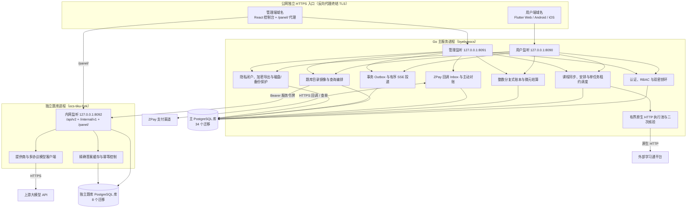

# 系统架构总览

> **适用范围**：系统整体拓扑、模块所有权与跨服务协作基准，对应仓库内已完整落地的生产代码架构。REST 与 SSE 细节以 [api/openapi.yaml](../../api/openapi.yaml) 为准。

## 1. 架构形态与核心取舍

ByebyeOCS 采用 **Linux 原生 Go 模块化单体（`server/`）配合独立题库服务（`services/tiku/`）** 的双进程、双数据库拓扑：

- **无中间件轻量化底座**：持久化队列、租约调度、复式账本、审计日志与事件 Outbox 全部由 PostgreSQL 16+ 事务直接承载；进程内有界协程池仅承担计算与网络唤醒，零 Redis、零消息队列、零容器编排依赖。
- **双监听与三端物理隔离**：主服务单进程同时绑定用户回环端口（默认 `127.0.0.1:8090`）与管理回环端口（默认 `127.0.0.1:8091`），分别挂载 Flutter Web 与 React 管理端静态产物；独立题库进程绑定内网回环端口（默认 `127.0.0.1:8092`），经管理端反向代理同域暴露 `/panel/` 维护面板。
- **原生 HTTP 执行**：所有课程读取、音视频/文档推进与测验交卷均通过原生 HTTP 协议适配器完成，生产运行环境无需无头浏览器、播放器或媒体解码器。

## 2. 进程拓扑与数据流图

## 3. 领域模块所有权矩阵

各内部包通过明确定义的应用接口协作，跨领域状态演进（如任务确认触发预占结算、充值验签触发入账与事件发布）由上层事务统一提交：

| 领域模块 | 代码落点 | 独占职责与数据 | 严格禁止的行为 |
| --- | --- | --- | --- |
| 身份与权限 | `server/internal/auth` | 外部主体探针校验、内部用户映射、Web 双端 Cookie/CSRF、原生双令牌、管理员 Argon2id+TOTP+RBAC、主密钥轮换 | 自行修改钱包余额、在日志或响应回显明文凭据 |
| 课程与调度 | `server/internal/learning` | 两阶段课程同步、多级目录树、共享页码缓存、封面安全代理、不可变安排版本、三级关闭识别、租约与 fencing 调度 | 绕过独立核验直接宣布任务完成、直接改写账本表 |
| 平台适配器 | `server/internal/adapters/chaoxing` | 单次操作隔离 Cookie 作用域、原生 HTTP 推进、几何字形还原、防重放交卷与只读复核 | 将纯请求记录伪造为真实媒体播放证据 |
| 复式账本 | `server/internal/ledger` | 人民币整数分 `journals`/`postings`、微元单价舍入、预占（Hold）/捕获（Capture）/释放（Release）、人工调账 | 浮点数金额计算、脱离业务唯一键无幂等入账 |
| 支付渠道 | `server/internal/payments` | ZPay 下单签名、管理口回调验签 Inbox、主动查单对账、原路退款状态流转 | 信任客户端同步回跳地址直接给钱包加款 |
| 题库编排 | `server/internal/questions` | 同步题库公开目录镜像、冻结查询价格与预算快照、前置失败恢复、用户答案问题报告与复核 | 在主库保存上游大模型 API 密钥、对 `usage_incomplete` 自动扣费 |
| 独立题库 | `services/tiku` | 上游提供商/模型热配置、一对一公开条目与只追加价格版本、规范化精确缓存、多槽位调用与 token 统计 | 跨库访问主平台钱包、以模糊相似检索冒充缓存命中 |
| 事件与运维 | `server/internal/events`、`operations` | Outbox 串行桥接、按角色过滤的 SSE 流、磁盘三级水位、异机备份时效门控、加密导出与隐私闭户 | 用内存队列替代数据库持久化事实源 |

## 4. 关键架构不变量

1. **单任务独占与证据三分**：并发锁粒度精确到“账号稳定主体 + 课程/班级/章节 + 任务点”，不同任务可在全局与单账号配额内并发；执行器观察进度、平台独立核验结果、真实媒体播放证据分列存储。
2. **双库物理隔离**：主平台与独立题库使用完全分离的 PostgreSQL 数据库与系统用户，通过受服务令牌保护的 HTTP 接口通信，不做跨库 SQL 连接。
3. **默认安全关闭**：外部平台探针、原生学习执行、题库调用、在线收款与自动扣费在配置层均默认关闭，缺少授权凭据、有效价格或新鲜异机备份时自动阻断高风险副作用。
