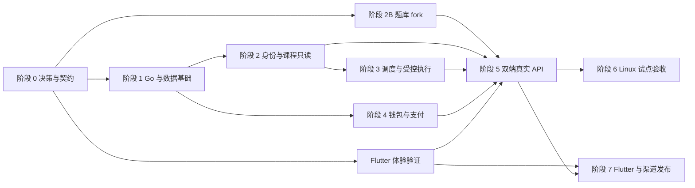

# 正式开发路线与验收门槛

状态：UI、PostgreSQL、Flutter、任务点用量与题库token分别计量、ZPay和约2C4G/30GB基线已确认。用户已授权完整业务实现与本地构建，Go主服务、独立题库、React管理端与真正Flutter工程均已建立。

路线依据 [架构总览](../architecture/overview.md)，实际实现与验证证据见 [当前验收](../development/local-implementation.md)，外部配置见 [集中清单](decision-checklist.md)。按功能证据收口，本地通过与真实平台、资金和分发验收分开记录。

| 阶段 | 本地实现 | 独立外部门槛 |
| --- | --- | --- |
| 0–1 契约/基础/身份权限 | 实际OpenAPI、显式迁移、双监听、认证/RBAC/偏好/限流与密钥轮换 | 真实稳定主体/授权依据 |
| 2/2B 课程与题库 | 只读适配、目录同步、独立fork、精确缓存、token记录和公开模型价格 | 真实学校兼容、模型密钥与公开价格 |
| 3 调度执行 | 任务租约/fencing、幂等控制、预检/独立核验、原生HTTP执行记录与账本连接 | 已授权目标课程执行；平台答题提交仍关闭 |
| 4 钱包支付 | 双分录、预占/结算/释放、订单/回调/对账/退款流程 | 商户与真实付款通知联调 |
| 5 双端应用 | React管理、Flutter Web真实API联调、偏好/事件/导出与闭户 | 生产来源、网络、真实数据边界 |
| 6 Linux交付 | 安装/升级/回滚/卸载、systemd、代理、备份/恢复工具 | 实际主机异机恢复和容量验收 |
| 7 原生发布 | 同工程Android/iOS源代码、Web release、Android debug APK | 实机、发布签名、macOS/iOS及下载站 |

## 依赖关系

外部授权、有效任务点单价和真实商户配置是对应能力启用的门槛，不阻止先做模拟契约、数据库和不产生副作用的验证。

## 阶段 0：决策、接口契约与可实施基线

- **功能/交付**：确认领域名词、稳定身份/任务键的验证方案；固定 OpenAPI 草案、错误/版本/幂等语义；固定 Flutter、用量模式和 ZPay 等已确认项，补齐计量/价格、授权和真实运行配置。
- **依赖条件**：已确认 UI 和研究报告；不需要真实账号或商户付款即可完成接口草案。
- **关键接口**：Identity、Catalog、TaskEngine、Verification、QuestionProvider、Pricing、Ledger、PaymentProvider、EventPublisher。
- **测试方式**：原型流程逐条映射契约；核查来源版本；设计异常、资金和恢复测试矩阵。
- **完成标准**：实体关系、状态、API 与 UI 术语一致；每个未决项有负责人、启用门槛和可继续的独立工作；无未经核实的 OAuth、平台能力或支付标准。
- **主要风险**：授权方式不支持第三方 SaaS，UID 或任务标识稳定性不够；这时保留模拟/只读范围并调整具体能力。

建议拆分：接口模型与 OpenAPI、稳定标识验证清单、支付/经营准入清单、Flutter release 验证包四个独立任务。

## 阶段 1：Go 服务、数据库和安全基础

- **功能/交付**：原生二进制骨架、配置校验、独立管理员认证、用户资源归属框架、PostgreSQL Repository 与连接池、迁移、健康与基本审计、外观偏好接口。
- **依赖条件**：阶段 0 契约；维护环境有对应原生数据库，公开环境要求单独文档化。
- **关键接口**：`/capabilities`、用户/管理员认证上下文、`/me/preferences`、UnitOfWork、迁移与诊断命令。
- **测试方式**：PostgreSQL 集成契约测试、配置优先级和秘密脱敏、认证/权限/CSRF、跨用户访问、重启及 schema 兼容。
- **完成标准**：空白目标 Linux 能运行独立二进制；外观默认石墨且三种配色可持久化；管理员和用户身份隔离；日志无秘密。
- **主要风险**：依赖维护者路径、PostgreSQL 事务/锁及连接池配置不当、管理员权限过宽。

阶段 1 拆为两个验收增量：1A 提供服务生命周期、配置、数据库与只读基础接口，目前已完成；1B 补齐管理员认证/RBAC、归属中间件、审计业务、已认证偏好和恢复等剩余要求。1A 的基础表仅为结构，不表示对应业务已实现。资金与外部执行功能仍关闭。

## 阶段 2：学习通身份与课程只读

- **功能/交付**：验证可用且获准的登录方式、稳定身份映射、加密平台会话、课程和章节同步、任务点与普通附件区分、失效提示及申诉入口。
- **依赖条件**：阶段 1；真实连接前必须具备适用授权、测试账号和当前平台协议核查。扫码未证实时不标记支持。
- **关键接口**：登录挑战与验证、`/me`、`/course-syncs`、`/courses`、平台只读核验。
- **测试方式**：脱敏固定样本；并发首次登录、重复关联、会话轮换和过期；小规模真实只读验证。
- **完成标准**：普通用户无需注册第二套账号；同一主体不会产生两个钱包；无明文凭据展示；统计不把普通附件算未完成。
- **主要风险**：主体作用域或学校差异、登录挑战不能在服务端合法完成、上游字段变化。

建议拆分：会话加密与主体映射、登录挑战、课程发现提取、同步与差异更新、账号申诉只读处理。

## 阶段 2B：题库 fork、模型目录与 token 用量

- **功能/交付**：从固定 upstream 建立独立 fork；迁移到 PostgreSQL 独立数据库；保留 v1 兼容，新增 v2 查询；公开模型条目、精确缓存、`cache_first`/`always_llm`、幂等 `request_id`、token/调用分解回传、缓存错误报告和内部管理 API。
- **依赖条件**：阶段 0 契约；上游模型服务、管理员面板中的初始模型条目、数据处理条款和 token 单价可在开发后补齐，但真实收费前必须确定。主平台先使用测试模型和测试价格。
- **关键接口**：fork `/api/v2/answers`、模型目录/缓存管理、`/question-models`、`/question-queries`、`usage.calls`、`Idempotency-Key`。
- **测试方式**：v1 回归、精确缓存与模糊候选隔离、模型禁用/视觉降级、token 分解、重复请求、超时/用量缺失、缓存失效、PostgreSQL 迁移与恢复、上游同步后的契约回归。
- **完成标准**：用户只能选已发布模型；两种模式行为符合定义；缓存命中 token 为 0 且不误报；成功和失败用量可区分；同一请求不重复调用/收费；上游密钥不出 fork。
- **主要风险**：fork 长期分叉冲突、共享缓存泄漏、错误缓存放大、上游 token 不完整、模型下架致安排中断。

## 阶段 3：安排、调度、恢复与可信核验

- **功能/交付**：不可变安排版本、稳定任务去重、公平调度、全局/账号名额、同任务独占、控制请求、分类重试、检查点、恢复核验和 SSE。
- **依赖条件**：阶段 2 数据；先使用可控 Adapter，真实执行需要具体任务能力和授权验证。收费仍可关闭。
- **关键接口**：`/plans`、`/tasks`、`/controls`、TaskEngine、Verification、租约与 Outbox/投递流。
- **测试方式**：同账号不同任务并发、同任务多实例、旧执行器续存、租约失联、取消与完成竞态、杀进程恢复、SSE 缺口和乱序。
- **完成标准**：只有平台新鲜查询可确认；恢复不盲目重放副作用；观察与媒体证据独立；403/429/验证码停止相关操作；修改进行中安排清楚表达生效边界。
- **主要风险**：数据库 fencing 无法阻止旧实例已发出的外部请求、平台并发实际限制、任务键变更。

建议拆分：安排/任务去重、名额领取、原生执行器提取、控制与恢复、平台核验、事件流。每部分先通过模拟故障测试，再联真实场景。

## 阶段 4A：钱包与计费内核

- **功能/交付**：整数分、规范用量事件及去重、双边分录、不可变账本、预占/结算/释放、异常退款资金、人工调整、价格快照和审计；题库 token 微元计价、结算批次和 `usage_incomplete` 处理。
- **依赖条件**：阶段 1；收费主轴和主服务计量单位已确定；生产收费前仍需配置有效任务点单价、题库 token 单价、成功条件和题库失败成本。开发测试使用明确标注的测试价格。
- **关键接口**：UsageMeter / UsageRecord / UsageSettlement、Ledger、Pricing、`/pricing`、`/usage`、`/wallet`、`/wallet-adjustments` 和独立题库 ChargeIntent。
- **测试方式**：性质测试和高争用并发扣费；重复尝试、重复结算、重建余额、失败回滚和锁冲突。
- **完成标准**：每笔 journal 平衡、缓存可重建、余额不透支；执行重试不产生第二个收费意图；人工操作有权限和原因。
- **主要风险**：按执行尝试收费、浮点解析、错误释放预占、把缓存余额当唯一来源。

## 阶段 4B：已核定支付服务与对账

- **功能/交付**：本地下单、固定提供商适配、通知 Inbox、验签、主动查单、幂等到账、迟到付款、退款待查和对账。
- **依赖条件**：4A；真实支付前核定商户后台/合同、经营类别与官方协议版本。没有官方沙箱时先用本地模拟器，任何真实付款试验需单独明确授权。
- **关键接口**：PaymentProvider、`/recharge-orders`、支付回调、`/reconciliations`、`/refunds`。
- **测试方式**：官方签名向量、重复/乱序/伪造通知、金额不符、下单超时、提交后断线、到账前重启、退款结果不明、关闭后迟到付款。
- **完成标准**：客户端返回不入账；已付与已到账独立；重复有效通知只记一笔；不丢弃第二笔真实资金；对账能恢复未决订单。
- **主要风险**：商户实际通道与文档差异、MD5 旧协议风险、异常退款限制、商户类别不获准。

## 阶段 5：双端真实 API 与题库人工确认

- **功能/交付**：管理员和用户界面接真实 API；课程/安排/钱包实时更新；角色限制、异常处理、模型目录选择、缓存模式、token 用量展示、OCS-Tiku 查询与提交确认；移除生产包中的演示控制。
- **依赖条件**：阶段 2/3/4；用户 Web 已确定 Flutter，需完成 release 体验验证。题库查询启用前固定 Provider 版本、成本和隐私授权，最终提交单独批准。
- **关键接口**：生成的 TS/Dart DTO、REST/SSE、Provider Tests、QuestionQuery/Submission、偏好同步。
- **测试方式**：从登录到安排、暂停、核验和账务的端到端测试；桌面/手机、六种外观组合、可访问性、跨标签页冲突、题库错误与超时。
- **完成标准**：所有重要按钮有真实且可解释的结果；没有模拟成功落入正式包；切换配色不改变业务状态；题库失败不默认提交。
- **主要风险**：沿用原型 localStorage 当账本/认证、全量事件刷页面、题目/图片泄漏、Web 首屏不达预算。

Flutter 体验验证独立验收：同一五个代表页、固定 SDK、release 构建、冷热缓存和真实设备测量；优化首屏、中文输入、键盘、可访问性和生命周期，不再将 React 用户 Web 列为待选。

题库 fork 与 Flutter 验证可并行，但真实模型查询、token 计费和缓存策略必须在阶段 5 的端到端验收前完成。

## 阶段 6：Linux 原生试点与运营准备

- **功能/交付**：版本化二进制、systemd、安装/升级/回滚、HTTPS 指引、备份恢复、告警、数据导出删除与小规模试点。
- **依赖条件**：阶段 5；平台授权、价格、商户和隐私范围已核定。首个公开试点不得靠维护者私有环境运行。
- **关键接口**：安装器、`config check/doctor/migrate/backup`、维护状态、受限健康与指标。
- **测试方式**：空白 Linux、amd64/arm64、约 2C4G / 30GB 指定目标；负载、断电/终止、磁盘满、数据库锁、密钥恢复和升级失败演练。
- **完成标准**：公开起始环境可按文档完成安装；恢复后资金和任务可核对；有实际容量与限制记录，分层清理及异机备份已配置并演练 RPO≤15 分钟/RTO≤4 小时目标；未验证课程不声称兼容。
- **主要风险**：单机磁盘故障、备份无法还原、数据库迁移阻塞通知、资源预算过于乐观。

此阶段先限定用户规模、任务类型与支撑渠道，依据证据扩展，不一次性宣称面向全部学习通课程。

## 阶段 7：Flutter 手机 App 与分发渠道

- **功能/交付**：同一 Flutter 工程的手机布局、系统主题、三配色、登录验证、课程/安排/钱包、后台恢复与支付回跳；通过自有下载站发布签名 Android APK。iOS 先使用 Flutter Web，原生分发待有效签名和适用条件满足。
- **依赖条件**：阶段 5 契约和技术验证；真实 iOS/Android 设备、发布签名、自有下载站配置、隐私披露及 iOS 适用分发条件核对。
- **关键接口**：安全存储、App 生命周期、APNs/FCM/地区推送、订单恢复、平台交易核验和退款通知。
- **测试方式**：进程被杀、离线、切后台、冷启动回跳、重复交易、跨设备偏好、键盘与安全区、实际签名安装与升级路径。
- **完成标准**：App 不承担后台学习执行；返回前台重取可信状态；按渠道显示正确支付能力；没有未经允许的外链收银入口；交付明确区分已签名可安装、自托管下载可用与仅本地构建；不承诺任意 iOS 用户可从网站直装。
- **主要风险**：iOS 分发资格/签名未满足、目标地区差异、Web/App 功能漂移、下载更新信任链和插件兼容。

## MVP 与后续范围

Web MVP 需要阶段 0–6 的必要项；手机正式发布按阶段 7 独立验收。首版只支持明确授权、能力已验证的任务类型。需要题库最终提交、可选播放执行器、多节点和高级财务审批的能力，可分开加入，不让首版无限膨胀。

多节点不作为 MVP。外部平台不识别 fencing token，因此未来扩容需重新设计副作用隔离，不能只添加 Worker 数量。

## 下一项正式开发建议

本地工程按 [当前验收](../development/local-implementation.md) 收口并生成可审查产物；真实学习通、商户、模型、价格、异机备份和App签名在对应能力启用前逐项配置与验收。Flutter、计量模式、ZPay、首版范围和主机预算已经确定，不重复询问。
