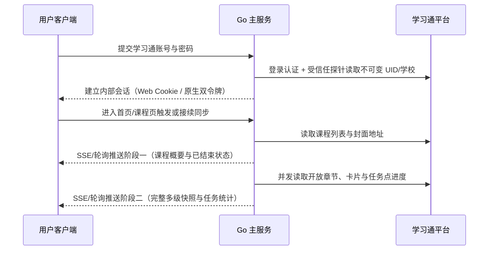
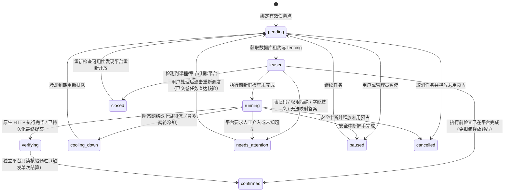

# 核心业务流程

> **适用范围**：正式服务端与三端客户端的真实业务流转规范。底层状态机与事务锁细节见 [任务调度]( ../architecture/scheduler.md) 与 [计费账本](../architecture/billing.md)。

## 1. 学习通身份登录与两阶段课程同步

1. **提交凭据**：用户在 `/login` 输入学习通账号与密码（原生移动端如未配置服务地址，先在 `/connect` 验证并保存自托管 HTTPS 地址）。
2. **主体核验与建档**：主服务创建短期登录挑战，向平台认证并调用受信任主体探针（JSON 探针或账户资料页 `profile` 探针）提取不可变平台 UID 与学校名称，通过长期身份索引密钥计算 HMAC 摘要，绑定或创建唯一内部用户与钱包，加密保存平台会话。
3. **两阶段课程同步**：进入首页或课程页时自动触发或接续同步：
   - **第一阶段（概要发布）**：在单次同步隔离 Cookie 容器内拉取课程列表，识别 `not-open-tip` 已结束课程标记与封面地址，批量落库课程概要，前端即刻展示全部课程卡片与封面。
   - **第二阶段（完整快照）**：按并发配额逐门拉取多级章节树、识别无进入链接的已关闭小节（`icon-bukaifang`）、读取开放章节的卡片页码目录与个人任务点状态，校验目录树完整性后原子提交新版课程快照；单门读取异常时保留该课上一次完整快照。

## 2. 创建学习安排与原生任务执行

1. **编排与绑定**：用户在 `/plans` 新建或编辑安排，搜索并勾选一门或多门未结束课程（范围统一覆盖所选课程的全部可用章节），选择任务类型（视频、音频、文档、测验）与优先级。服务端生成不可变安排新版本，跳过已关闭课程、已关闭章节与已关闭任务点，绑定待完成的有效任务点并按单价规则执行余额预占（未开启扣费时记免费快照）。
2. **单任务独占领取**：调度器在全局并发与单账号并发配额内，按稳定任务键获取 PostgreSQL 租约与递增 fencing token。
3. **执行前新鲜复核**：Worker 调用前先向平台发起只读状态检查：
   - 若平台已显示任务完成，直接转为“平台已确认”并全额释放本次预占，不产生重复请求与扣费；
   - 若发现课程已结束、章节已关闭或测验已截止，标记对应 `platform_closed` 可用性并退出待处理队列。
4. **原生 HTTP 推进与二次核验**：
   - 视频与音频按新鲜卡片下发的时长、保存进度、上报间隔与签名参数按真实时间节奏上报观察进度（忽略纯前端抓拍弹窗配置，遇到平台真实人脸/验证码拦截时停止该任务并转“需要处理”）；
   - 文档阅读发送考核请求，若响应明确包含完成事实或复查确认通过则结清；
   - 执行上报完成后，必须经过独立的平台只读复核确认通过，才推进至 `confirmed` 终态并触发单次用量结算。暂时网络故障自动进入最多两轮冷却恢复。

## 3. 全自动章节测验与题库精确缓存

1. **选择模型与模式**：用户在安排中启用“测验”，选择题库面板已发布的公开模型条目（图片题可由视觉模型直接作答，或由后台自动串联图片转述模型）以及复用方式（“优先复用答案”或“每次调用模型”）。
2. **题面还原与冻结查询**：执行器读取未作答工作页；若平台返回未开放或明确截止（含保留只读/残留表单的截止页），立即标为 `quiz_closed` 并不调用题库。正常试卷若含 `font-cxsecret` 动态混淆字体，由内置原版字体几何轮廓目录精确还原明文；主服务按当前公开条目冻结价格版本、模型输出 token 预算与缓存策略，按必要额度预占余额后携带幂等键请求独立题库 `POST /api/v2/answers`。
3. **作答与结算**：
   - `cache_first` 命中规范化完全一致的精确缓存时，直接返回缓存答案，消耗 token 为 `0`；
   - 未命中或指定 `always_llm` 时调用上游大模型，返回完整答案（保留英文缩写与完整选项文本）及各槽位输入/输出 token 明细，主服务按冻结微元单价结算预占（若返回 `usage_incomplete` 或未定价则跳过自动扣费）。
4. **防重放提交与独立复核**：执行器在最终提交前重读试卷核对题目、选项顺序与作答机会，确认无误后**先在主库持久化最终提交意图**，再向平台发送交卷请求；随后独立读取测验工作页核实具体的已提交答案或批阅分数。若交卷响应因网络中断丢失，后续恢复或重新调度仅执行独立只读复核，绝不二次提交试卷。

## 4. 钱包充值、对账与异常退款

1. **创建充值订单**：用户在 `/wallet` 输入金额并发起充值，主服务创建本地待支付订单并返回 ZPay 跳转参数。
2. **异步验签与原子入账**：客户端支付完成回跳仅用于刷新订单视图，绝不直接增加余额。主服务管理监听接收 `/payments/callbacks/zpay` 异步通知，校验商户签名与金额一致后写入回调 Inbox，在同一 PostgreSQL 事务内更新订单状态、写入复式账本分录（借记渠道清算、贷记用户可用余额）并发布 SSE 钱包更新事件。
3. **主动对账与退款分离**：对延迟或未决通知，管理员可在 `/finance` 触发主动查单补偿入账。消费争议走“服务费用退回钱包”分录，重复充值等渠道异常走“原路退款预留 → 渠道退款确认”两步分录，严禁直接篡改余额数值。

## 5. 答案报告复核与个人隐私闭户

- **答案问题报告**：用户在独立题库查询页对存疑答案提交问题报告；管理员在 `/tasks` 底部复核区查看报告，可记录处理意见或直接调用题库内部接口使对应精确缓存失效。
- **数据导出与删除申请**：用户在 `/settings` 申请导出数据时，系统后台生成有界加密归档供本人短期下载；提交账号删除申请后，系统立即吊销该用户全部 Web/原生会话与学习通平台凭据、停止在途任务并跳转 `/deletion-receipt`。管理员在 `/privacy-requests` 核实无未决充值与预占后完成闭户匿名化，不可变财务账本与审计流水依法脱敏保留。
