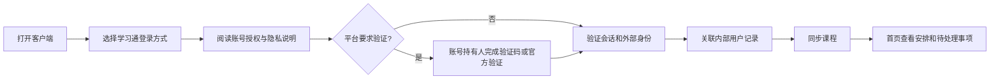
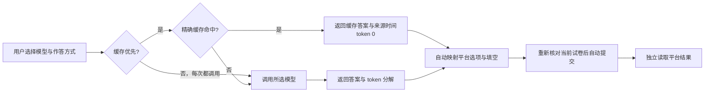
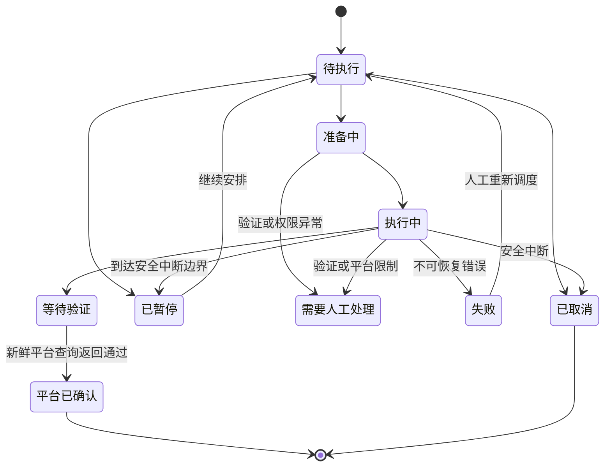

# 核心用户流程

## 进入学习空间

候选扫码与验证码均是视觉演示。没有官方可用性证据前，不宣称已支持授权登录或 OAuth。

原型操作：进入登录页，点击“填入演示身份”；可开启“演示验证要求”，使用 123456 完成合成验证。输入的账号密码不进入本地持久化。

## 安排学习

1. 从首页、独立任务安排入口或课程详情进入任务安排。
2. 新建安排或编辑现有安排，选择一门或多门课程。
3. 选择视频、文档、测验等类型，以及全部或手动章节范围。
4. 设置优先级并保存；有进行中任务时，明确显示修改用于后续任务。
5. 在同一页面查看当前任务、需要处理和任务历史。
6. 需要时暂停安排；正在执行的任务可单独暂停、取消或查看详情。

安排启用题库策略后，全自动取题、查询答案、填写、最终提交与独立平台复核，无需人工确认。原型仍使用合成数据，正式实现与受控协议验证见[本地验收](../development/local-implementation.md)。

同一安排的多个编辑页面使用版本冲突提示。正式实现应由服务端执行条件更新，不能依赖客户端版本判断保证一致性。

## 选择答题模型与作答方式

1. 用户在安排中启用“测验”后，看到管理员已发布的模型条目，而不是上游模型名。每条显示名称、简短说明、能力（文本/图片）和“价格待公布/按已发布单价”。
2. 用户选择具体已发布条目，安排版本固定该公开模型 ID；作答方式默认建议为缓存优先。
3. 用户选择作答方式：
   - **优先使用已有答案**：只有相同题目、选项顺序、题型、图片、模型和提示词版本的精确缓存才命中；命中时显示来源模型与时间，token 为 0。
   - **每次都使用模型作答**：忽略读取缓存，调用模型；成功结果可写入缓存供以后使用。
4. 保存后，后续查询使用该组合；进行中的查询保留原模型、模式和价格快照。
5. 模型被管理员下架或不可用时，后续任务进入“需要处理”，提示重新选择，不静默改用其他模型。
6. 图片题若模型不支持视觉，系统可使用管理员配置的图片转述模型；该额外调用单独显示 token，不能隐藏。

缓存命中不等于提交成功；后台按当前试卷自动映射与提交，平台确认单独读取。无法唯一映射时停止，提交结果不明时只核验。错误缓存可报告并失效。

## 确认进度

该图表达产品语义，完整调度状态机、租约和恢复规则在 UI 确认后设计。原型通过手动模拟事件展示状态变化，不自动将计时结束等同于完成。

## 充值到账

1. 选择金额与支付方式，校验金额范围与小数位。
2. 创建本地合成订单，展示待支付状态。
3. 在原型控制区触发“支付成功”，余额保持原值。
4. 再触发“余额到账”，原子演示订单状态、单条流水和余额更新。
5. 关闭面板后仍能从充值记录找到订单；已到账记录在刷新后保留。
6. 已关闭或异常订单进入支持说明和人工复核入口。

正式服务必须通过支付服务端通知验签、主动查单与账务事务完成第 3、4 步；客户端返回页无权直接入账。

## 管理员定位异常

运行总览的异常摘要 → 筛选后的任务监控 → 任务详情 → 账号身份和会话详情 → 暂停或等待用户验证 → 查看历史与审计。

管理员不能通过读取明文 Cookie 或密码解决验证问题。解除账号限制也不直接把失效会话标为有效。

## 账号变化与数据请求

账号变更、重复关联与余额争议 → 身份申诉 → 核验外部主体和原订单 → 审批资金或归属变更。原型提供说明与模拟申请，正式复核接口待后续设计。

数据导出不包含认证信息；删除申请需处理任务、未结算余额和必要财务记录的保留义务。
